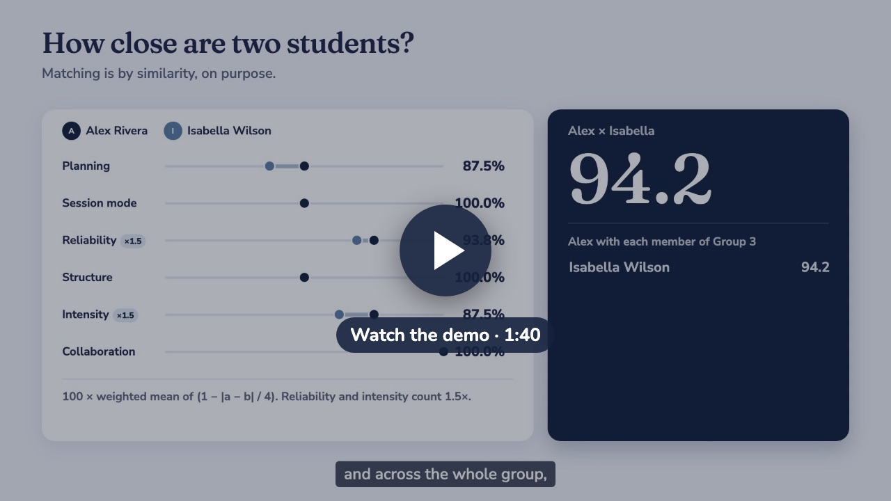
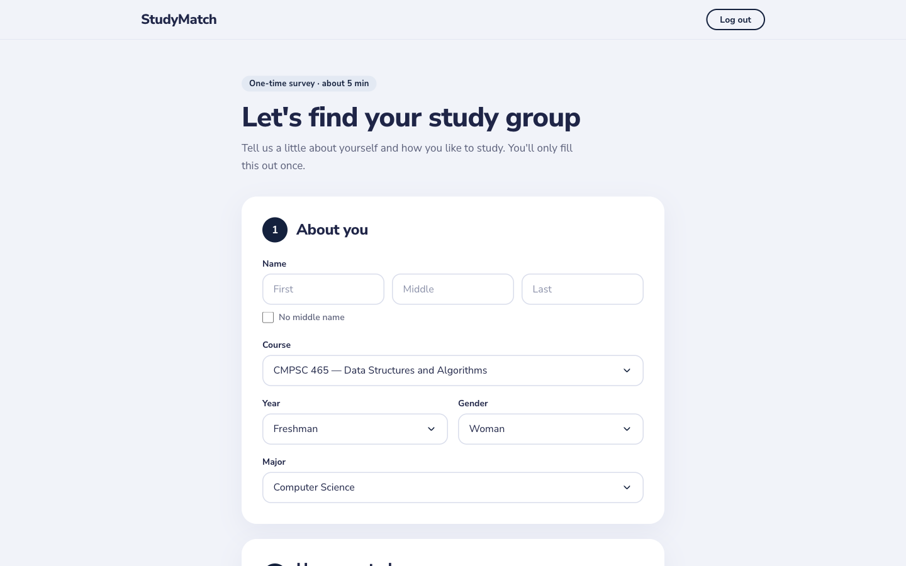
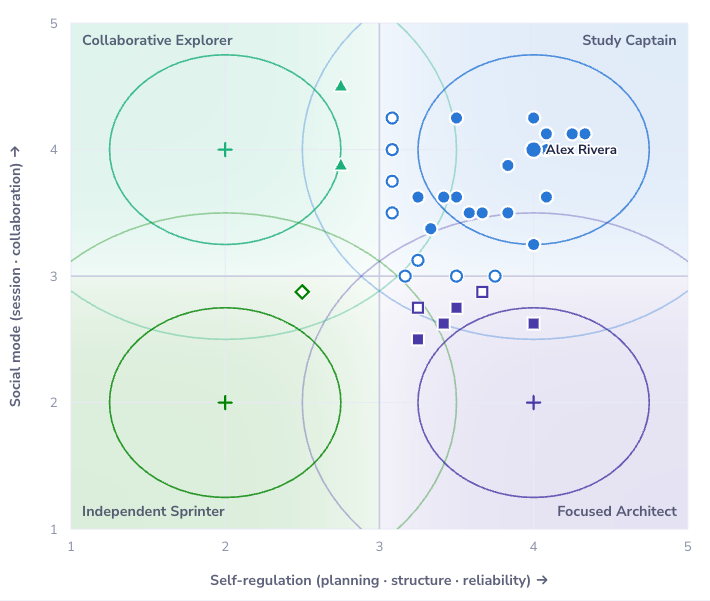
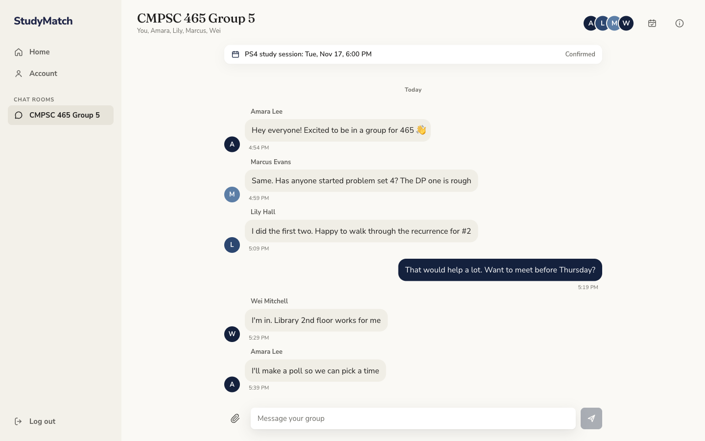
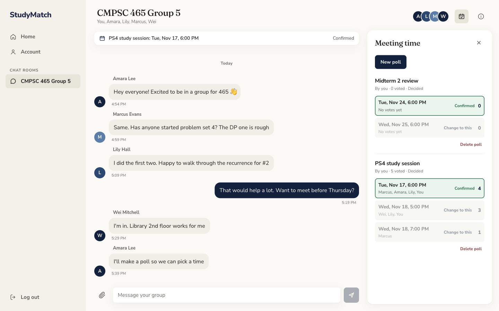
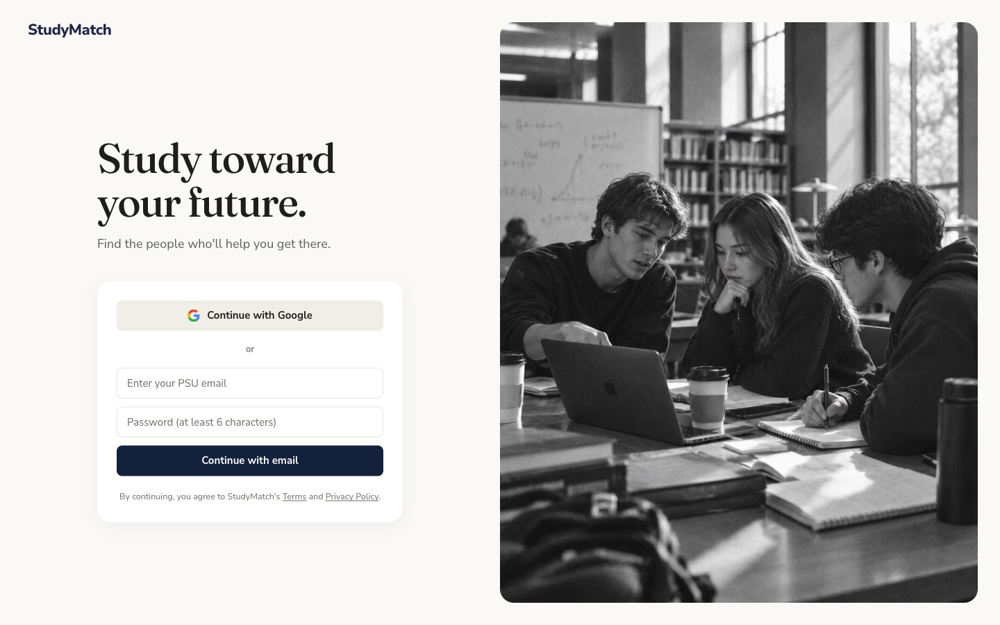

<p align="center">
  
</p>

<h3 align="center">Find classmates in your course who study the way you do.</h3>

<p align="center">
  Answer 24 questions in about five minutes. StudyMatch places you in a group of four or five from the same course,<br/>
  then gives the group a private chat and a shared calendar to plan sessions.
</p>

<p align="center">
  <a href="https://studymatch-8qih.onrender.com"></a>
  &nbsp;
  <a href="https://github.com/WoosungLim01/StudyMatch/releases/tag/v0.1.0"></a>
</p>

<p align="center">
  <a href="https://github.com/WoosungLim01/StudyMatch/releases"></a>
  <a href="LICENSE"></a>
  
  
</p>

<p align="center">
  <a href="docs/ARCHITECTURE.md">How it works</a> ·
  <a href="docs/RESEARCH.md">Research</a> ·
  <a href="#for-universities">For universities</a> ·
  <a href="#roadmap">Roadmap</a> ·
  <a href="CHANGELOG.md">Changelog</a>
</p>

<p align="center">
  <a href="https://github.com/WoosungLim01/StudyMatch/releases/tag/v0.1.0">
    
  </a>
</p>

## Features

<table>
<tr>
<td width="40%" valign="middle">
<h3>Five-minute survey</h3>
24 statements on a 5-point scale, nothing pre-selected. Your answers become six study-style scores: planning, session mode, reliability, structure, intensity and collaboration.
</td>
<td width="60%">
<picture><source media="(prefers-color-scheme: dark)" srcset="docs/assets/survey-dark.png" /></picture>
</td>
</tr>
<tr>
<td width="40%" valign="middle">
<h3>Groups formed by optimization</h3>
Each course is split into groups of four or five that score highest together, solved exactly with Google OR-Tools. Late sign-ups join the best-fitting group with an open seat.
</td>
<td width="60%">
<picture><source media="(prefers-color-scheme: dark)" srcset="docs/assets/typemap-dark.png" /></picture>
</td>
</tr>
<tr>
<td width="40%" valign="middle">
<h3>Private group chat</h3>
Text, photos, video and files, visible only to your group.
</td>
<td width="60%">
<picture><source media="(prefers-color-scheme: dark)" srcset="docs/assets/chat-dark.png" /></picture>
</td>
</tr>
<tr>
<td width="40%" valign="middle">
<h3>Pick a time together</h3>
Anyone can start a poll. Once a time is confirmed, it shows on every member's calendar in their own time zone.
</td>
<td width="60%">
<picture><source media="(prefers-color-scheme: dark)" srcset="docs/assets/polls-dark.png" /></picture>
</td>
</tr>
<tr>
<td width="40%" valign="middle">
<h3>Sign in with email or Google</h3>
Email with a 6-digit code, or Google. Light and dark mode follow your system.
</td>
<td width="60%">
<picture><source media="(prefers-color-scheme: dark)" srcset="docs/assets/login-dark.jpg" /></picture>
</td>
</tr>
</table>

<sub>Screenshots use synthetic students and a local test account. No real student data.</sub>

## Does matching help?

We haven't run a real pilot yet, so these results come from a 14-week simulation of 1,000 synthetic students, calibrated on public survey data.

| Strategy | Unhappy at week 14 | Students who quit a group |
|---|---|---|
| Keep the first groups | 25% | 95 |
| Regroup on weekly feedback | 19% | 74 |
| Regroup and learn the matching weights | **12%** | **40** |

> [!IMPORTANT]
> When a language model judged each simulated week instead of fixed rules, regrouping still helped, but matched groups did no better than random ones. The spring 2027 pilot is designed to settle this with real students. Details in [`docs/RESEARCH.md`](docs/RESEARCH.md).

## For universities

StudyMatch is free for students and for partner universities. We're looking for one department to run a one-semester pilot in one to three high-enrollment courses.

- **Opt-in only.** Students choose to take part and can delete their account and data at any time.
- **No grades.** Matching uses only the 24 survey answers. Course performance is never collected.
- **Aggregates only.** A department sees placement and retention numbers, never individual answers.
- **Open source.** Licensed under AGPL-3.0, so your IT and privacy teams can review every line.
- **Low running cost.** About $13 a month for hosting and database at pilot scale.

Interested? [Open a pilot inquiry](https://github.com/WoosungLim01/StudyMatch/issues/new?template=pilot_inquiry.yml).

## Roadmap

Proposed, and depends on finding a partner department.

| When | Milestone |
|---|---|
| Dec 2026 – Jan 2027 | Security and privacy hardening, consent notices, Privacy Policy and Terms of Use |
| Jan 2027 | Partner department, survey item rewrite, weekly feedback form |
| Spring 2027 | One-semester pilot with about 100 students |
| Summer 2027 | Pilot report and continuation decision |

Current gaps are listed in [`docs/KNOWN_LIMITATIONS.md`](docs/KNOWN_LIMITATIONS.md).

## Run it yourself

```bash
git clone https://github.com/WoosungLim01/StudyMatch.git
cd StudyMatch
pip install -r requirements.txt
python app.py        # http://localhost:8010
```

It ships with 36 synthetic students in two courses. Production setup (Turso, Resend email, Google sign-in, the admin password) is in [`docs/DEPLOYMENT.md`](docs/DEPLOYMENT.md).

<details>
<summary>Built with</summary>

Python 3.10 · FastAPI · Google OR-Tools CP-SAT · scikit-learn · SQLite locally, Turso in production · Resend for email · plain HTML, CSS and JavaScript

</details>

## Contributing

Bug reports and ideas are welcome: see [`CONTRIBUTING.md`](CONTRIBUTING.md). To report a security problem privately, see [`SECURITY.md`](SECURITY.md).

## Team

| Name | GitHub |
|---|---|
| Anoop Ibrampur | [@AnoopIbrampur](https://github.com/AnoopIbrampur) |
| Woojoo Song | [@CosmosBoy112](https://github.com/CosmosBoy112) |
| Li Zhu | [@JJ69c](https://github.com/JJ69c) |
| Taegwon Lee | [@TaegwonL](https://github.com/TaegwonL) |
| Woosung Lim | [@WoosungLim01](https://github.com/WoosungLim01) |

## License

[AGPL-3.0](LICENSE). You're free to use, study and change StudyMatch. If you run a modified version as a public service, you must share your changes under the same license.

<p align="center"><sub>Started as a Penn State DS 440 capstone, Fall 2026. Not affiliated with or endorsed by Penn State.</sub></p>
